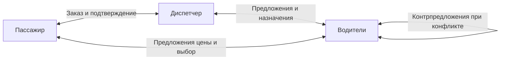

# Постановка задачи: «Шашечки» — многоагентная система такси

Учебный проект по курсу «Теория многоагентных систем». Репозиторий: `MultyAgenticSystems`, ветка `main`, исходное состояние `6fe843d`, 30.10.2026.

Статус: черновик для вычитки. Тема такси, диспетчеризация и конфликт водителей с торгом согласованы пользователем. Название, технические решения, параметры экспериментов и веб-демонстрация ниже предложены ассистентом и пока не утверждены.

## 1. Контекст и цель задачи

### 1.1. Учебный контекст

Пассажир создаёт заказ. Несколько водителей хотят его выполнить, но отличаются местоположением, занятостью и приемлемой ценой. Диспетчер организует обмен заявками и подтверждение исполнителя. Интерес пассажира — приемлемая цена и короткое ожидание; интерес водителя — доход с учётом затрат и времени простоя.

На одной системе выполняются четыре работы: проектирование МАС, сравнение распределения задач, исследование конфликтов и переговоров, диверсионный анализ. «Умное распределение» в этом проекте означает решения по состоянию агентов и явным правилам, эффективность которых проверяется экспериментами.

Агрегатор такси служит понятным примером предметной области. Проект использует собственную учебную модель; устройство и алгоритмы Яндекс Такси не исследовались.

### 1.2. Что есть сейчас

В коммите `6fe843d` сохранены `README.md` с требованиями курса и `.gitignore`. Прикладного кода, интерфейса и результатов экспериментов пока нет. Подтверждён выбор темы: водители, диспетчеры, распределение заказов и торг при конфликте двух водителей у пассажира.

### 1.3. Техническая цель

После реализации локальный симулятор воспроизводит поездки, распределение заказов, переговоры и неблагоприятные сценарии. Каждый запуск сохраняет настройки, журнал событий и показатели. На одинаковых исходных сценариях можно сравнить механизмы и подготовить четыре отдельных отчёта.

### 1.4. Идея решения

Предлагается дискретно-событийная симуляция условного города. Движение, обмен сообщениями и ожидание измеряются модельным временем. Алгоритмы агентов и взаимодействия пишутся явно. Предлагаемая реализация: Python для модели и экспериментов, HTML/CSS/JavaScript для локального веб-экрана; внешние сервисы для базовой версии не требуются.

Сначала создаётся модель с запуском из командной строки. Затем к тому же ядру подключается интерфейс. Так алгоритмы можно проверять и запускать серии опытов независимо от анимации.

### 1.5. Связанные документы

- `Лабораторные-МАС.pdf`, страницы 1–2: обязательные требования курса, состав работ и форма сдачи. Краткая выписка — в [README](../README.md).
- `МАС. Лекция 1.pdf` — `МАС. Лекция 5.pdf`: предоставленные материалы курса; необходимые определения будут сверяться при подготовке соответствующей работы.
- [План выполнения](plan.md): последовательность работ, ожидаемые результаты и точки проверки.
- Шаблон: `my-task-loop/references/postanovka-template.md`; структура адаптирована под Markdown и учебный проект.

### 1.6. Связанные задачи

Не затрагивается: проект ведётся локально, без внешнего трекера.

## 2. Функциональные требования

### 2.1. Основа системы

Модель включает условный город, водителей, диспетчера и пассажирские заказы. В базовом сценарии работает один диспетчер; несколько диспетчеров рассматриваются как возможное расширение. Город задаётся небольшой координатной сеткой, расстояние и время движения вычисляются по опубликованным правилам.

| Роль | Цель и знания | Действия и полномочия |
| --- | --- | --- |
| Водитель | Получать доход с учётом затрат; знает свою позицию, занятость, расходы и полученные предложения | Оценивает заказ, предлагает цену, принимает или отклоняет предложение, движется, выполняет поездку, участвует в торге |
| Диспетчер | Обслуживать поток заказов; знает заявки, полученные сообщения водителей и подтверждённые назначения | Запрашивает предложения, назначает водителя по выбранному механизму, проверяет актуальность подтверждений и переназначает заказ |
| Пассажир, связанный с заказом | Получить поездку в пределах бюджета и допустимого ожидания; знает условия заказа и полученные предложения | Создаёт заявку, оценивает предложения по явному правилу, подтверждает выбранную цену и исполнителя или отказывается |

Действия агентов определяются их локальными знаниями и правилами. Симулятор хранит истинное состояние среды для проверки результата; агент получает только предусмотренные моделью наблюдения и сообщения.

Для лабораторной №1 будут формализованы множество агентов, среда, наблюдения, локальные состояния, цели, действия, переходы состояний, сообщения, роли, полномочия и доступные средства. Отдельно описываются правила связи и стоимость коммуникаций.

Предварительный граф связи:

Это эскиз каналов взаимодействия. Формальная диаграмма ролей и граф коммуникаций входят в результат лабораторной №1.

### 2.2. Поведение после реализации

1. **Обычная поездка.** Пассажир задаёт точки подачи и назначения, бюджет и допустимое ожидание. Водитель оценивает заказ. После подтверждения единственного исполнителя проходят подача, посадка и поездка. Завершение отражается в состояниях агентов и метриках.
2. **Два механизма распределения.** Централизованное назначение использует сведения, доступные диспетчеру; аукцион собирает предложения, которые рассчитывают водители. Для основного сравнения задаются единые ограничения заказа и критерий выбора: цена плюс время подачи, умноженное на общую стоимость единицы ожидания. При равных оценках действует опубликованное правило разрешения равенства.
3. **Торг у пассажира.** Отдельный сценарий создаёт конкурирующие предварительные предложения: два водителя приезжают к одному пассажиру до окончательного подтверждения исполнителя. Оба предлагают цену и могут отвечать снижением на предложение соперника. Каждый обычный водитель учитывает собственную минимально приемлемую цену, пассажир — бюджет и предел ожидания.
4. **Завершение конфликта.** Предлагается максимум три раунда торга; он также заканчивается раньше, если участники больше не меняют предложения. Среди оставшихся допустимых предложений пассажир выбирает минимальную цену; при равной цене учитывается простой водителя, затем стабильный идентификатор. Диспетчер подтверждает результат. Если допустимого предложения нет или истёк предел ожидания пассажира, заказ отменяется. Параметры и выбранный исход записываются в журнал.
5. **Сравнение до и после переговоров.** Одинаковая конфликтная ситуация запускается с простым правилом «первое допустимое предложение» и с ограниченным торгом. Сравниваются цена поездки, время разрешения конфликта, сообщения, затраты водителей, распределение дохода и соблюдение ограничений. Минимальная цена пассажира сама по себе не считается достаточным признаком качества.
6. **Неблагоприятные сценарии.** Сценарий задаёт отказ водителя, ложное сообщение или нарушение протокола. Один и тот же набор воздействий запускается до и после введения защит. Сохраняются условия внесения сбоя, трасса, нарушение или успешное восстановление.
7. **Повторяемость.** Сценарий, начальное состояние, входной поток заказов, случайные воздействия и настройки сохраняются вместе с результатом. Входные потоки формируются до запуска и одинаковы для сравниваемых механизмов; одного совпавшего seed недостаточно, если алгоритмы потребляют случайные числа в разном порядке.
8. **Демонстрация.** Пользователь выбирает сценарий и механизм, запускает модель и видит заказы, водителей, назначения, предложения цены, сообщения и итоговые показатели. Результат можно воспроизвести без веб-интерфейса.

### 2.3. Правила и граничные случаи

| Ситуация | Поведение |
| --- | --- |
| Нет свободного или согласного водителя | Заказ ожидает до своего предела ожидания, затем фиксируется отмена с причиной |
| Два водителя приехали к одному пассажиру | Они могут торговаться, но посадка разрешена только одному подтверждённому исполнителю |
| Все цены выше бюджета | Пассажир не подтверждает поездку; торг ограничен числом раундов и временем |
| Водитель не хочет снижать цену | Он оставляет предложение в силе либо выходит из торгов; снижение не принудительное |
| Два равных предложения | Применяется одно и то же явно описанное правило приоритета |
| Повторное или запоздавшее сообщение | В защищённом режиме оно проверяется по идентификатору сообщения, версии заказа и текущему состоянию |
| Водитель пропал до посадки | После тайм-аута его назначение отзывается; новый водитель получает новую версию назначения |
| Водитель пропал после посадки | Заказ отмечается как незавершённый с отказом; пассажир не переносится в другую машину автоматически |
| Прежний водитель вернулся после переназначения | Устаревшее назначение не даёт права забрать пассажира |
| Пустой поток заказов или нет водителей | Симуляция завершается с корректными счётчиками; неопределимые средние отмечаются как отсутствующие |

В защищённом режиме сохраняются ограничения: один пассажир одновременно находится максимум в одной машине; водитель выполняет максимум одну поездку; завершённый заказ не исполняется повторно; подтверждённая цена укладывается в бюджет пассажира. Допустимость цены водителя проверяется по его правилам, а последствия злонамеренного поведения учитываются в анализе отказов.

## 3. Backend-спецификация

### 3.1. Предлагаемые компоненты

Пути предварительные; окончательная структура будет определена в техническом плане после вычитки постановки.

- `src/shashechki/model.py`: город, заказ, состояние водителя, часы и очередь событий.
- `src/shashechki/agents.py`: решения водителя, диспетчера и пассажира, их цели, знания и полномочия.
- `src/shashechki/allocation.py`: централизованное назначение и аукцион с явными правилами.
- `src/shashechki/negotiation.py`: ограниченные переговоры и выбор предложения.
- `src/shashechki/faults.py`: воспроизводимые неблагоприятные воздействия и переключение защит.
- `src/shashechki/experiments.py`: запуск серий, расчёт показателей и экспорт результатов.
- `src/shashechki/cli.py` и `web.py`: командный запуск и локальная демонстрация одного ядра модели.
- `scenarios/`, `tests/`, `web/`, `reports/`: сценарии, проверки, интерфейс и четыре отчёта.

Исходные сценарии и параметры хранятся в читаемых файлах. Трассы сохраняются в JSONL, сводные результаты — в CSV и JSON. Серверная БД и миграции в базовом варианте не требуются. Настройки включают механизм распределения, механизм переговоров, ограничения торга, задержки сообщений, случайные воздействия и режим защит.

### 3.2. Программа четырёх лабораторных

| Работа | Реализация и исследование | Результат для сдачи |
| --- | --- | --- |
| №1. Спецификация и архитектурное проектирование | Формальное описание агентов и среды; роли, цели, знания, состояния, действия, полномочия и средства; каналы и правила взаимодействия; диаграмма ролей, граф коммуникаций, обоснование архитектуры и пригодности для следующих работ | Отдельный отчёт №1 и диаграммы. Полная реализация приложения в перечне требований именно к этой работе не указана |
| №2. Распределение задач и координация | Рабочая модель и два механизма; парные запуски при обычном потоке, дефиците водителей и задержках сообщений | Отчёт №2 с описанием алгоритмов, условиями опытов, таблицами, графиками и выводами; исходники и материалы демонстрации отдельно |
| №3. Переговоры и разрешение конфликтов | Два приехавших водителя; простое разрешение конфликта и ограниченный торг; разные бюджеты, затраты и загрузка; проверка эффективности, справедливости и ограничений | Отчёт №3 со сравнением до и после механизма, трассой показательного конфликта и разбором выигрышей и потерь участников |
| №4. Диверсионный анализ и надёжность | Набор воздействий, трассы, выявленные отказы, защитные ограничения, повторные запуски | Отчёт №4 с матрицей «воздействие → отказ → защита → остаточное ограничение» и сравнением результатов |

План лабораторной №4 включает следующие случаи:

| Воздействие | Предлагаемая защита и граница её возможностей |
| --- | --- |
| Водитель перестаёт отвечать до посадки | Тайм-аут подтверждения, отзыв назначения и повторное распределение |
| Водитель сообщает ложную позицию или время подачи | Проверка допустимости движения и согласованности сообщений; правдоподобную ложь без независимого наблюдения полностью обнаружить нельзя |
| Старая заявка или подтверждение доставляется повторно | Уникальные идентификаторы, версия заказа и проверка допустимого перехода состояния |
| Два противоречивых назначения одного заказа | Единственное актуальное подтверждение и проверка его перед посадкой |
| Агент с изменённой целью бесконечно торгуется или срывает обязательства | Предел раундов, тайм-аут и отзыв права на исполнение; инцидент остаётся в журнале |
| Диспетчер недоступен | Агенты не начинают неподтверждённые поездки; заказы ожидают или отменяются. Это безопасная остановка, доступность полностью не восстанавливается |

Последние две защиты не гарантируют успешную поездку: исследование должно различать сохранение ограничений и способность продолжать обслуживание.

### 3.3. Показатели и условия экспериментов

| Группа | Показатели |
| --- | --- |
| Обслуживание | Доля завершённых и отменённых заказов, ожидание пассажира, время от заявки до завершения |
| Работа водителей | Простой, пробег без пассажира, доход и прибыль с учётом модельных затрат |
| Коммуникация | Число сообщений и раундов, суммарные задержки, модельная стоимость сообщений; фактическое время вычислений измеряется отдельно |
| Конфликты и справедливость | Цена поездки, время разрешения конфликта, доля водителей без поездок, распределение прибыли, индекс Джейна по неотрицательным доходам |
| Надёжность | Число нарушений ограничений, обнаруженных отказов, успешных переназначений и время восстановления |

Для нулевых доходов всех водителей индекс Джейна не определён; это отражается явно. Справедливость анализируется вместе с затратами, доступностью и временем участия водителей, а не только по одному индексу.

Предлагаемая начальная серия: 10 водителей, 100 заказов и 10 заранее сформированных входных потоков на условие. Демонстрация конфликта включает 2 водителей и 1 пассажира. Это рабочие параметры проекта, а не требования преподавателя. После пилотных прогонов проверяется достаточность числа повторов.

В каждом сравнении фиксируются исходные данные и все условия, кроме исследуемого механизма или защиты. Для переговоров фиксируется механизм распределения; для надёжности — оба механизма. Публикуются результаты отдельных прогонов, средние значения и разброс. Отсутствие улучшения или дополнительные накладные расходы являются допустимым результатом исследования.

### 3.4. Логирование

Каждое событие содержит `run_id`, `event_id`, модельное время, тип события, отправителя, получателя, `order_id`, версию заказа и причину действия; для сообщений — `message_id`. Переговоры сохраняют раунд, предложения и результат выбора. Внесённый сбой и сработавшая защита отмечаются отдельно.

Полный журнал наблюдателя может включать истинное состояние среды. Эти данные используются для проверки и не передаются агентам автоматически.

## 4. Frontend-спецификация

Локальный веб-экран предложен для удобства демонстрации. Методичка требует возможность показать разные режимы, но не обязывает делать веб-приложение.

Экран показывает условную карту, водителей, пассажиров, активные заказы и выбранного исполнителя. Панель запуска позволяет выбрать сценарий, механизм распределения, переговоры и защиты. Доступны пауза, шаг и воспроизведение сохранённого запуска.

При конфликте одновременно видны два водителя, текущие цены, раунд, ограничения пассажира и итог выбора. Рядом отображаются журнал событий и сводные показатели. Ошибка сценария объясняется до запуска; отсутствие подходящего водителя и отмена заказа показаны как результаты модели.

## 5. Тестирование

### 5.1. Сценарии

- Проверки модели: корректное время и движение; только допустимые переходы состояния; запрет повторной посадки и повторного завершения заказа.
- Распределение: нет исполнителей, один исполнитель, равные предложения, отказ от назначения, ответ после окончания срока.
- Переговоры: два водителя у пассажира; снижение цены; выход участника; равные цены; бюджет ниже всех допустимых предложений; исчерпание раундов.
- Надёжность: каждый запланированный отказ до и после защиты, включая возвращение водителя с устаревшим назначением.
- Повторяемость: одинаковые входные потоки и настройки дают одинаковую событийную трассу и метрики; фактическое время вычислений в это равенство не входит.
- Локальная проверка демонстрации: показ обычной поездки, аукциона, конфликта с торгом, отказа и восстановления; проверка соответствия экрана сохранённой трассе.

### 5.2. Критерии приёмки

- [ ] Отчёт №1 содержит все элементы формального описания, обе диаграммы и обоснование архитектуры.
- [ ] Два механизма распределения реализованы явно и запускаются на одинаковых исходных данных.
- [ ] Сценарий пользователя «двое приехали и торгуются за заказ» воспроизводится с видимыми предложениями и единственным подтверждённым исполнителем.
- [ ] Для лабораторной №3 есть сопоставимые результаты до и после переговоров с оценкой эффективности, справедливости и ограничений.
- [ ] Для каждого неблагоприятного сценария сохранены трассы до и после защиты и описаны остаточные ограничения.
- [ ] Команды запуска, входные данные, настройки и результаты достаточны для повторения опытов.
- [ ] Есть демонстрация разных режимов, исходники и четыре отдельных отчёта с результатами и выводами.
- [ ] Код и демонстрационные материалы предоставляются отдельно от текста отчётов; оформление экспериментальных таблиц и графиков согласуется при подготовке отчётов.
- [ ] Локальные проверки проходят; публикация и push выполняются только по отдельной команде пользователя.

## 6. Дополнительная информация

### 6.1. Риски

- **Торг повторяет распределение из лабораторной №2.** В №2 исследуется назначение по предложениям до подачи; в №3 — отдельная ситуация конкурирующих водителей у пассажира и переговоры с контрпредложениями.
- **Агенты становятся пассивными объектами диспетчера.** У водителя остаются локальные знания, оценка выгоды, право отказа и выбор предложения; у пассажира — ограничения и решение о подтверждении.
- **Нельзя честно сравнить механизмы.** Входные потоки формируются заранее, условия и критерии публикуются, результаты не подбираются под победу одного алгоритма.
- **Дешёвая поездка получается за счёт убытка водителей.** Вместе с ценой измеряются прибыль, затраты, простой и справедливость; обычные агенты учитывают минимальную приемлемую цену.
- **Условная модель переносится на реальное такси без оснований.** Выводы ограничиваются заданными допущениями и исследованными сценариями.
- **Сроки курса требуют уточнения.** В исходном PDF не указан год; календарь сессии отсутствует. Сроки сохранены в README без предположений об их актуальности.

### 6.2. Возможные доработки вне базовой задачи

| Доработка | Что даст |
| --- | --- |
| Реальная дорожная карта и маршрутизация | Более реалистичное время подачи и поездки |
| Несколько диспетчеров и резервирование управления | Отдельное исследование распределённой диспетчеризации |
| Обучение стратегий водителей или LLM-агенты | Исследование адаптации за пределами заданных правил |
| Публичное размещение, аккаунты и мобильный клиент | Удалённую демонстрацию и многопользовательский доступ |

### 6.3. Сложность и статус решений

Сложность средняя: основные усилия приходятся на модель взаимодействия, воспроизводимые эксперименты и четыре содержательных отчёта. Полноценный коммерческий сервис такси в объём проекта не входит.

Согласовано: предметная область такси, диспетчеризация, конкуренция за заказ и торг двух приехавших водителей; подготовка постановки и плана; локальная работа без push. На вычитку вынесены рабочее название «Шашечки», Python, локальный веб-экран, предложенные правила и параметры опытов.

Spec-kit не запускался. Этот документ и план подготовлены вручную; реализация начнётся после принятия постановки и уточнения технического плана.
