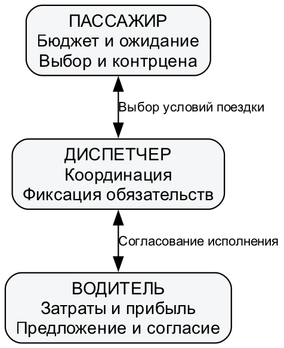
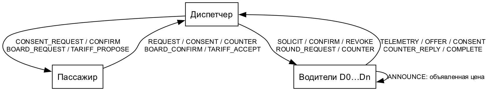
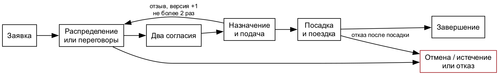
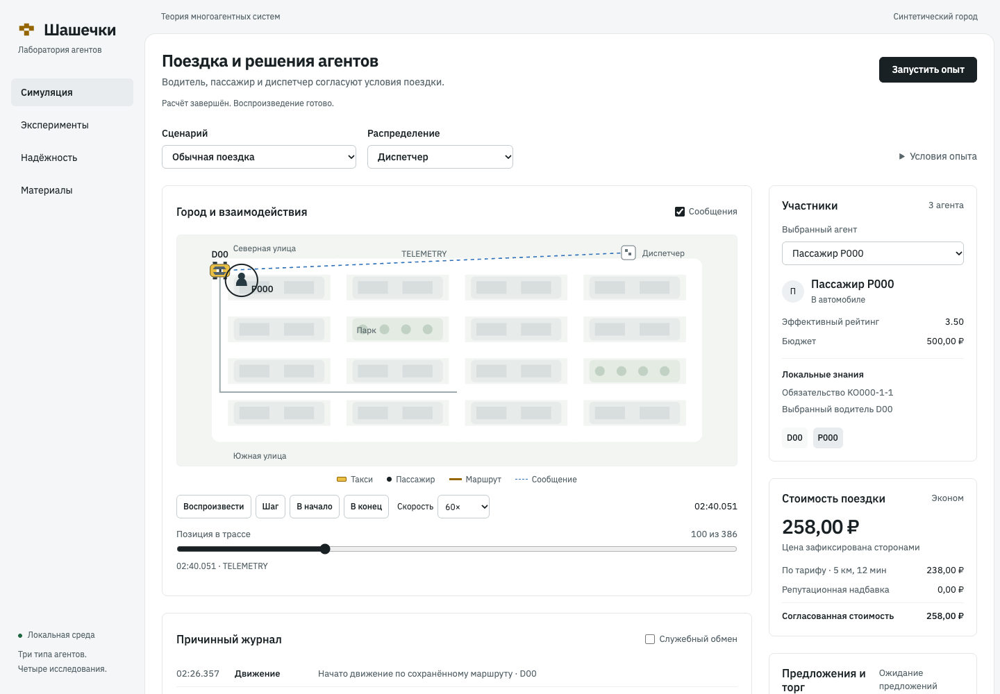

# Лабораторная работа №1

# Спецификация и архитектура системы «Шашечки»

Дисциплина: теория многоагентных систем. Дата: 31 октября 2026 года.

## Цель и постановка

Разработать формальную модель службы такси для исследования координации, переговоров и устойчивости. Водители самостоятельно оценивают выгоду, пассажиры выбирают допустимые условия, диспетчер согласует распределение. Предмет исследования — правила взаимодействия; география и тарифы синтетические.

## Задача и среда

Исследуется координация водителей, пассажиров и диспетчера на условном дорожном графе.
Город G=(V,E): направленные рёбра имеют положительные длину и время проезда.
A=D∪P∪{c}; D — водители, P — пассажиры, c — диспетчер. Среда содержит модельное время,
положение, доступность средств, очередь сообщений и проверенный реестр обязательств.
Модель не описывает реальное ценообразование конкретной службы такси.

Для агента i задаются see_i(E,inbox_i), next_i(I_i,see_i) и action_i(I_i).
Наблюдение доступно только через предусмотренные каналы; наблюдатель исследования видит
полное состояние, но не является аргументом функции решения агента.

| Роль | Цель | Знания | Состояния | Действия / средства / полномочия |
| --- | --- | --- | --- | --- |
| Водитель | Прибыль при ограничениях затрат и занятости | Собственная позиция/расходы/порог, полученные заявки, объявления цен и рейтинг пассажира | Свободен, предлагает, зарезервирован, подаёт, торгуется, перевозит, недоступен | Маршрут, предложение/снижение/сохранение/выход, согласие, движение; не назначает себя и не пишет чужой рейтинг |
| Пассажир | Поездка в пределах бюджета, ожидания и требований к водителю | Собственный бюджет/тарифы/история и доставленные предложения | Запрашивает, оценивает, торгуется, ожидает, в машине, прибыл, отказ | Заявка, выбор/отказ, встречная цена, согласование тарифа и посадки; не подтверждает за водителя |
| Диспетчер | Обслуживание и непротиворечивые обязательства | Доставленная телеметрия, заявки/предложения, версии, согласия и резервы | Доступен либо недоступен; очередь и фазы заказов | Рассылка, фильтрация/оценка, запрос согласия, атомарное подтверждение, отзыв и ограниченное переназначение |

Карта, часы, транспорт сообщений, маршрутизатор и реестр — средства среды, а не дополнительные
автономные агенты. Роль отличается от числа экземпляров: диспетчер один, водителей/пассажиров много.

## Информация и взаимодействие

Заявка передаёт диспетчеру бюджет и ограничения пассажира. Телеметрия сообщает позицию,
занятость и публичную наценку водителя; индивидуальный порог остаётся у него.
Центральный механизм рассчитывает предложения по последним доставленным сведениям,
аукцион собирает обязывающие предложения водителей. В обоих случаях водитель и пассажир
могут отказать, критерий выбора одинаков. Сообщения, наблюдения и основания решений журналируются.
Граф коммуникаций отделён от дорожной карты.

## Автоматы и обязательства

Заказ: заявка → распределение → согласия → назначение → подача → посадка → поездка → завершение.
До посадки возможны отмена/истечение; отказ после неё сохраняет фактическую позицию и незавершённость.
Смена тарифа или отзыв повышает версию и аннулирует старые согласия. Максимум три раунда
и два переназначения, общий срок пассажира не продлевается. Предварительный подъезд двух
водителей в конфликтной сцене не является окончательным назначением.

Инварианты защищённого режима: один исполнитель заказа; одна поездка водителя;
пассажир максимум в одной машине; однократное завершение; одинаковые цена/тариф/версия
в двух согласиях. Физическая связность и целостность проверенного рейтинга действуют во всех режимах.

## Архитектура и теоретические основания

Архитектура сочетает автономные локальные решения и центральную фиксацию обязательств.
Она позволяет исследовать распределение (работа №2), переговоры интересов (№3) и отказ
участника/средства (№4) в одном ядре. Потоки ОС не нужны для автономности; модельное время
задаёт дискретно-событийная очередь. Интерфейс воспроизводит сохранённые события и не рассчитывает цены.

Основания: лекция 1, с. 6 — свойства агента; лекция 2, с. 6, 17, 19, 22, 24, 27 —
локальное состояние, знания, связь и показатели; лекция 3, с. 14, 17, 27, 29 —
решения, роли и полномочия; лекция 4, с. 18–19, 24, 28 — диспетчеризация,
аукционы и цена коммуникации; лекция 5, с. 9, 22, 25, 31, 33, 35 —
конфликт, контрпредложения, арбитраж, обязательства и репутация. Номера обозначают
страницы PDF, начиная с первой. Закупочный аукцион услуги выбирает минимальную обобщённую стоимость,
поэтому не тождественен аукциону продажи по максимальной ставке.

Ограничения: синтетический граф, детерминированные стратегии и учебные тарифы;
один диспетчер создаёт точку отказа; правдоподобная ложь не всегда обнаружима;
десять повторов не гарантируют достаточной статистической мощности.

## Функции агента

I_i — локальное состояние и знания. see_i получает адресованные доставленные сообщения и разрешённые собственные наблюдения. next_i обновляет I_i по версии заказа, сроку и содержанию сообщения. action_i выбирает действие по детерминированной стратегии.

Для водителя see включает собственную позицию, затраты и доставленную заявку; next сохраняет допустимые предложения и обязательство; action вычисляет цену, отвечает на контрцену, даёт согласие либо отказывает и выполняет подтверждённый маршрут. Для пассажира see включает доставленные условия; next хранит предложения, выбранного водителя и версию; action проверяет бюджет, ожидание и рейтинг, предлагает контрцену, принимает тариф и подтверждает посадку. Для диспетчера see включает заявки, телеметрию и ответы; next обновляет очередь и согласия; action объявляет запрос, выбирает предложение и атомарно фиксирует обязательство.

Один процесс исполнения не отменяет автономности: стратегии используют разные локальные состояния и могут отклонять решения других участников. Потоки операционной системы не используются как модель агентов.

## Диаграмма ролей

Прямоугольник обозначает роль; стрелка — взаимодействие в пределах полномочий. Диспетчер не может дать согласие за водителя или пассажира.

## Направленный граф коммуникаций

Стрелка — адресованный канал; подпись — тип сообщения. Самопетля множества водителей обозначает обмен объявленными ценами между разными водителями. Физические дороги представлены отдельным графом города и не являются каналами сообщений.

## Жизненный цикл заказа

Каждое обязательство связано с номером версии. Старое сообщение не возобновляет отозванную поездку. До посадки допускается ограниченное переназначение; после посадки отказ завершает поездку неуспехом с сохранением фактической позиции.

## Реализация и проверка модели

Общее ядро написано на Python 3.12+ со стандартной библиотекой. Модули domain, agents, protocol, routes, pricing и reputation разделяют типы, стратегии, протокол и средства среды. HTML/CSS/JavaScript-интерфейс показывает сохранённые присваивания состояний; повторное моделирование в браузере не производится.

В очереди событий используется порядок (модельное время, фаза, номер). Доставка на границе срока обрабатывается до закрытия окна. Деньги хранятся в копейках, дробные промежуточные значения — Fraction. Профили связи и внешние воздействия сохраняются до запуска вариантов.

По матрице L1.1–L1.4 определены задача, три роли со всеми характеристиками, самостоятельные схемы ролей/коммуникаций и обоснование архитектуры. Численные сравнения выполнены отдельно в работах №2–№4.

## Вывод

Гибридная архитектура сохраняет локальные интересы участников и обеспечивает проверяемую фиксацию обязательств. Она позволяет менять механизм распределения, переговорную стратегию и защитный профиль в одном экспериментальном ядре. Центральный диспетчер остаётся точкой отказа, что исследуется в работе №4.

## Источники и отдельные приложения

1. «Лабораторные-МАС.pdf», с. 1–2: содержание четырёх работ и общий комплект сдачи.
2. «МАС. Лекция 1.pdf», с. 6: свойства агента.
3. «МАС. Лекция 2.pdf», с. 6, 17, 19, 22, 24, 27: состояние, знания, граф связи, показатели.
4. «МАС. Лекция 3.pdf», с. 14, 17, 27, 29: решения, роли и полномочия.
5. «МАС. Лекция 4.pdf», с. 18–19, 24, 28: диспетчеризация, аукционы, коммуникационные затраты.
6. «МАС. Лекция 5.pdf», с. 9, 22, 25, 31, 33, 35: конфликт, контрпредложения, арбитраж, обязательства, репутация.

Страницы отсчитываются от первой страницы PDF. Формулы тарифов и параметры опытов являются проектными решениями, а не обязательными положениями лекций.

Исходный код предоставлен отдельно: `evidence/source.zip`. Входы всех пар и полные отобранные прогоны с конфигурациями, трассами, показателями и контрольными суммами: `evidence/demo.zip`. Компактные парные таблицы: `evidence/`; инструкция запуска: `README.md`. Архивы находятся рядом с отчётами в локальном проекте; внешняя публикация не выполнялась.
