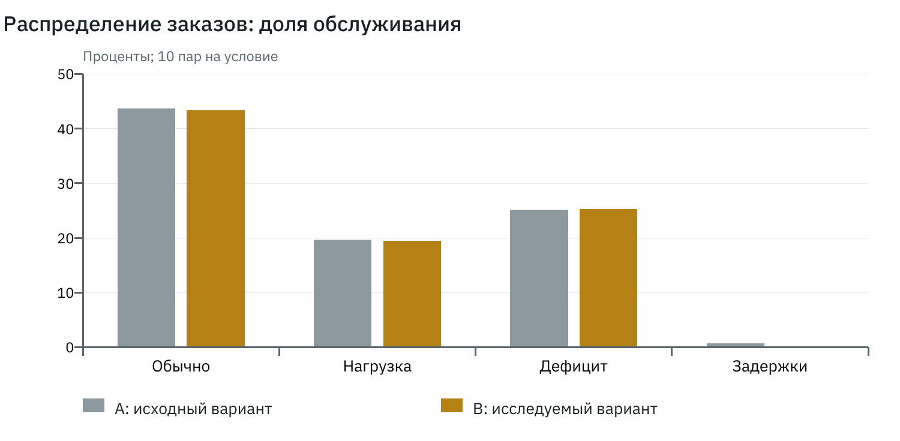

# Лабораторная работа №2

# Сравнение механизмов распределения заказов

Дисциплина: теория многоагентных систем. Дата: 31 октября 2026 года.

## Цель и реализация

Сравнить централизованное назначение A и аукцион предложений B на одинаковом спросе. Диспетчер A вычисляет условия по доставленной телеметрии и публичной наценке; индивидуальный порог водитель проверяет при собственном согласии. В B водители вычисляют обязывающие предложения, диспетчер собирает их в течение 2000 мс. В обоих вариантах требуются согласия пассажира и водителя.

Общий критерий: G = цена в копейках + ETA_мс / 60 + 1000 × (5 − рейтинг водителя). Предложения фильтруются по классу, бюджету, сроку ожидания и минимальному рейтингу. При равном G выбирается более длительный простой, затем меньший стабильный ID. Порог собственных затрат не читается диспетчером из скрытого состояния.

## Условия опытов

Граф города — сетка 5×5 с направленными рёбрами в обе стороны, 1 км и 120 с на ребро. В каждом прогоне 100 заказов и 10 водителей, из них пять класса economy и пять comfort. Бюджеты 300–900 руб., допустимое ожидание 900 с. Истории фиксированы; репутационная надбавка отключена; переговоров нет; защита включена.

normal: интервал заявок 15–45 с; high_load: 5–15 с; scarcity: первые восемь водителей недоступны до 1800 с; delays: заранее материализованные задержки 500–2500 мс для каждого направления ролей и секундного интервала. Обычная задержка — 50 мс. Четыре условия × 10 seeds × 2 варианта = 80 прогонов, 40 полных пар.

## Методика и показатели

На каждый вариант заранее сохраняется один и тот же InputBundle; внутри пары совпадает input_hash. Псевдослучайные потоки orders, characteristics и communication инициализируются независимыми SHA-256-метками seed. Основные seeds: 0–9. Средние вычисляются по 10 прогонам; Δ = B − A; SD — выборочное стандартное отклонение десяти парных разностей. Для пропусков показываются отдельные числа доступных наблюдений; отсутствие поездки не подменяется нулевой ценой или ожиданием.

Доля обслуживания = completed / все заказы; cancelled, expired, failed и censored учитываются отдельно. Ожидание измеряется от заявки до посадки, выполнение — до завершения. Конверты и их UTF-8-байты считаются при отправке. Условные затраты координации: 1 копейка на отправку + 1 копейка на 1000 байт + 1 копейка на решение; итог округляется до копейки. Это исследовательская шкала, не реальная стоимость связи.

Прибыль = выручка завершённых поездок − затраты фактического движения, включая предварительную подачу обоих кандидатов. Отрицательная прибыль допустима. Jain = (Σx)² / (n Σx²) по выручке всех водителей, включая нулевые доходы; при всех нулях показатель не определён. Вычислительное время perf_counter хранится отдельно и не входит в каноническое сравнение.

## Результаты

| Условие | Показатель | A | B | Δ | SD Δ | n A/B/пар |
| --- | --- | --- | --- | --- | --- | --- |
| normal | Обслуживание, % | 43.70 | 43.40 | -0.30 | 0.48 | 10/10/10 |
| normal | Ожидание, с | 317.46 | 321.59 | 4.13 | 11.02 | 10/10/10 |
| normal | Отправки, шт. | 8497.70 | 9493.00 | 995.30 | 425.78 | 10/10/10 |
| normal | Координация, руб. | 110.49 | 132.50 | 22.01 | 5.44 | 10/10/10 |
| normal | Прибыль, руб. | 7041.20 | 6959.80 | -81.40 | 125.49 | 10/10/10 |
| normal | Jain выручки | 0.97418 | 0.97378 | -0.00039 | 0.00231 | 10/10/10 |

| Условие | Показатель | A | B | Δ | SD Δ | n A/B/пар |
| --- | --- | --- | --- | --- | --- | --- |
| high_load | Обслуживание, % | 19.70 | 19.50 | -0.20 | 0.63 | 10/10/10 |
| high_load | Ожидание, с | 290.42 | 292.66 | 2.24 | 22.33 | 10/10/10 |
| high_load | Отправки, шт. | 4188.70 | 5302.10 | 1113.40 | 57.74 | 10/10/10 |
| high_load | Координация, руб. | 54.82 | 78.24 | 23.42 | 0.72 | 10/10/10 |
| high_load | Прибыль, руб. | 3214.80 | 3188.00 | -26.80 | 130.27 | 10/10/10 |
| high_load | Jain выручки | 0.94501 | 0.94561 | 0.00060 | 0.00647 | 10/10/10 |

| Условие | Показатель | A | B | Δ | SD Δ | n A/B/пар |
| --- | --- | --- | --- | --- | --- | --- |
| scarcity | Обслуживание, % | 25.20 | 25.30 | 0.10 | 0.74 | 10/10/10 |
| scarcity | Ожидание, с | 320.95 | 313.55 | -7.41 | 15.68 | 10/10/10 |
| scarcity | Отправки, шт. | 5305.20 | 6419.50 | 1114.30 | 26.71 | 10/10/10 |
| scarcity | Координация, руб. | 69.32 | 88.01 | 18.69 | 0.34 | 10/10/10 |
| scarcity | Прибыль, руб. | 4062.80 | 4104.00 | 41.20 | 129.76 | 10/10/10 |
| scarcity | Jain выручки | 0.85607 | 0.84709 | -0.00898 | 0.02553 | 10/10/10 |

| Условие | Показатель | A | B | Δ | SD Δ | n A/B/пар |
| --- | --- | --- | --- | --- | --- | --- |
| delays | Обслуживание, % | 0.70 | 0.00 | -0.70 | 1.06 | 10/10/10 |
| delays | Ожидание, с | 98.46 | — | — | — | 4/0/0 |
| delays | Отправки, шт. | 7223.00 | 8248.70 | 1025.70 | 108.33 | 10/10/10 |
| delays | Координация, руб. | 102.96 | 114.46 | 11.51 | 1.95 | 10/10/10 |
| delays | Прибыль, руб. | 81.40 | -3.00 | -84.40 | 174.50 | 10/10/10 |
| delays | Jain выручки | 0.17250 | — | — | — | 4/0/0 |

Наблюдения для времени ожидания в delays: A — четыре прогона с посадками, B — ни одного; парное изменение не определено. Это среднее средних прогонов, а не среднее по объединённым поездкам. Полные десять парных наблюдений каждого показателя доступны в `evidence/allocation/observations.csv`; исходные числа и причины пропусков — в pairs.json.

## Фактическое время вычисления

| Механизм | Среднее, мс | SD, мс |
| --- | --- | --- |
| A: диспетчер | 258.77 | 106.44 |
| B: аукцион | 308.45 | 67.40 |

Время замерено локально Python 3.14.3; на него влияют фоновые процессы, файловый ввод-вывод измеряется отдельно. Оно не является временем ожидания пассажира.

## Анализ и ограничения

При обычной нагрузке доли обслуживания близки: 43,7% и 43,4%; аукцион требует примерно на 995 отправок больше на прогон. Повышенная нагрузка уменьшает обслуживание примерно до 20% при обоих механизмах. В дефиците машин аукцион даёт малое положительное среднее изменение 0,1 процентного пункта при SD 0,74 пункта; устойчивое превосходство из этого не следует.

При задержках до 2500 мс окно аукциона 2000 мс часто закрывается раньше получения полного ответа. Обслуживание B равно нулю, A — 0,7%. Это результат сочетания выбранного протокола и сроков, а не универсальная оценка аукционов. Для практического применения требуются адаптация окон и повторные исследования. Отрицательная средняя прибыль B в delays связана с фактическими затратами движения без выручки.

## Вывод

Оба механизма реализованы и проверены на общих входах. В выбранных режимах аукцион увеличивает коммуникационные затраты и не даёт устойчивого преимущества по обслуживанию. Существенное ограничение — фиксированные сроки на фоне задержек; модель позволяет измерить последствия их изменения отдельным опытом.

## Источники и отдельные приложения

1. «Лабораторные-МАС.pdf», с. 1–2: содержание четырёх работ и общий комплект сдачи.
2. «МАС. Лекция 1.pdf», с. 6: свойства агента.
3. «МАС. Лекция 2.pdf», с. 6, 17, 19, 22, 24, 27: состояние, знания, граф связи, показатели.
4. «МАС. Лекция 3.pdf», с. 14, 17, 27, 29: решения, роли и полномочия.
5. «МАС. Лекция 4.pdf», с. 18–19, 24, 28: диспетчеризация, аукционы, коммуникационные затраты.
6. «МАС. Лекция 5.pdf», с. 9, 22, 25, 31, 33, 35: конфликт, контрпредложения, арбитраж, обязательства, репутация.

Страницы отсчитываются от первой страницы PDF. Формулы тарифов и параметры опытов являются проектными решениями, а не обязательными положениями лекций.

Исходный код предоставлен отдельно: `evidence/source.zip`. Входы всех пар и полные отобранные прогоны с конфигурациями, трассами, показателями и контрольными суммами: `evidence/demo.zip`. Компактные парные таблицы: `evidence/`; инструкция запуска: `README.md`. Архивы находятся рядом с отчётами в локальном проекте; внешняя публикация не выполнялась.
