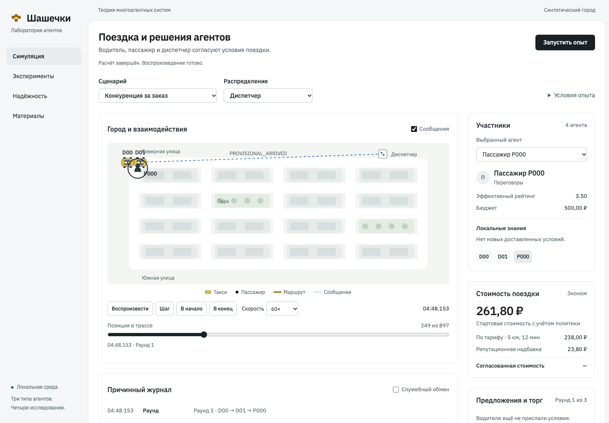
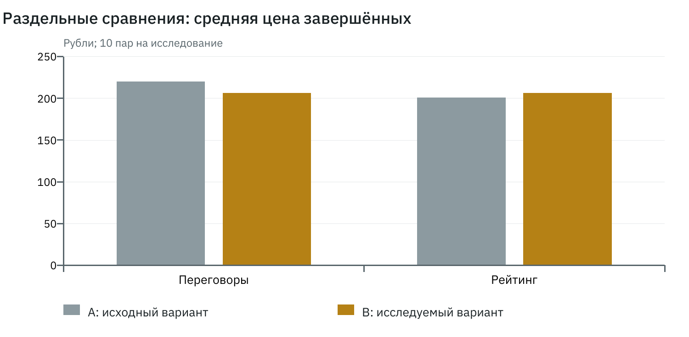

# Лабораторная работа №3

# Переговоры, тарифы и репутация участников

Дисциплина: теория многоагентных систем. Дата: 31 октября 2026 года.

## Цель и конфликт интересов

Два водителя предварительно приезжают к одному пассажиру и конкурируют за единственный заказ. Их подача оплачивается собственными расходами, окончательного назначения до согласий нет. Пассажир ограничивает цену и ожидание; водитель — прибыль и допустимый класс. Дополнительный конфликт возникает при недостаточном бюджете на исходный тариф.

## Протокол переговоров

После прибытия обоих кандидатов диспетчер открывает раунд. Водители объявляют цены; после сбора ответов пассажир предлагает max(минимум тарифа, min(бюджет, минимальная цена) − 10 руб.). Каждый водитель явно принимает контрцену, снижает собственное предложение на decrement до своего порога, сохраняет цену или выходит. Решение выбирается после ответов всего раунда либо по его сроку, а не по первому быстрому ответу.

Не более трёх раундов по 2000 мс. При отсутствии прогресса или допустимого предложения возможен отказ. При тесном бюджете участники могут явно согласовать economy вместо comfort; номер версии повышается, прежние предложения и согласия аннулируются, общий срок не продлевается. Подтверждение требует двух согласий на одинаковые цену, тариф и версию.

A выбирает первое допустимое предложение без торга; B применяет переговоры, включая согласованную смену тарифа. При равенстве используются G, простой и ID. Отдельные контрольные сцены проверяют сохранение цены, отказ снижать и отсутствие соглашения.

## Тариф и репутационная политика

Эконом: max(200; 100 + 18 × км + 4 × мин); комфорт: max(300; 160 + 25 × км + 6 × мин). Эффективный рейтинг r = (22,5 + сумма оценок) / (5 + число оценок). Для десяти оценок по 3 он равен 3,50. Надбавка s = min(0,15; 0,10 × max(0; 4,5 − r)); стартовая цена = базовая × (1+s), округление HALF_UP до копейки.

Для 5 км и 12 мин базовая economy — 238,00 руб.; при r=3,50 стартовая — 261,80 руб.; базовая comfort — 357,00 руб. Собственная цена водителя не ниже тарифного минимума и округлённых вверх ожидаемых затрат плюс минимальная прибыль. Согласованная цена остаётся неизменной при последующем обновлении истории. Рейтинг сам по себе не является основанием отказа пассажиру.

## Методика и показатели

На каждый вариант заранее сохраняется один и тот же InputBundle; внутри пары совпадает input_hash. Псевдослучайные потоки orders, characteristics и communication инициализируются независимыми SHA-256-метками seed. Основные seeds: 0–9. Средние вычисляются по 10 прогонам; Δ = B − A; SD — выборочное стандартное отклонение десяти парных разностей. Для пропусков показываются отдельные числа доступных наблюдений; отсутствие поездки не подменяется нулевой ценой или ожиданием.

Доля обслуживания = completed / все заказы; cancelled, expired, failed и censored учитываются отдельно. Ожидание измеряется от заявки до посадки, выполнение — до завершения. Конверты и их UTF-8-байты считаются при отправке. Условные затраты координации: 1 копейка на отправку + 1 копейка на 1000 байт + 1 копейка на решение; итог округляется до копейки. Это исследовательская шкала, не реальная стоимость связи.

Прибыль = выручка завершённых поездок − затраты фактического движения, включая предварительную подачу обоих кандидатов. Отрицательная прибыль допустима. Jain = (Σx)² / (n Σx²) по выручке всех водителей, включая нулевые доходы; при всех нулях показатель не определён. Вычислительное время perf_counter хранится отдельно и не входит в каноническое сравнение.

## Отдельные серии

Каждая серия содержит 10 пар по 100 конфликтов и 10 водителей. Пары водителей чередуются; интервал заявок — 300000 мс с сохранённым seed-зависимым отклонением ±5000 мс. Маршрут N00→N01: 1 км, 2 мин; машины реально возвращаются к следующей заявке. Наценки 0–20 руб. с шагом 5 и задержки 25–100 мс выбираются до обоих вариантов.

В negotiation рейтинг фиксирован и одинаков в A/B. Каждая пятая заявка исходно comfort с бюджетом 270 руб.; остальные economy с бюджетами 250/500 руб. В rating тариф economy и переговорный протокол одинаковы, меняется только правило off/fixed. Начальные группы рейтинга имеют 34/33/33 участника. Дополнительная конфигурация dynamic-reputation предусмотрена, но её серия не включена в выводы.

## Первое допустимое предложение и переговоры

| Показатель | A | B | Δ | SD Δ |
| --- | --- | --- | --- | --- |
| Доля обслуживания | 0.80 | 1.00 | 0.20 | 0.00 |
| Цена завершённых, руб. | 219.88 | 206.66 | -13.22 | 2.80 |
| Ожидание, мс | 114711.65 | 116808.29 | 2096.64 | 43.34 |
| Общая прибыль, руб. | 16030.09 | 18715.90 | 2685.81 | 231.94 |
| Jain выручки | 0.39964 | 0.99963 | 0.59998 | 0.00045 |
| Координация, руб. | 794.86 | 811.99 | 17.13 | 0.06 |

Все 10 пар полные. Рост обслуживания с 80% до 100% включает согласованное снижение класса для 20 заявок, которые A не обслуживает. Поэтому средние цены завершённых поездок относятся к разным наборам заказов.

Для сопоставимой когорты из 80 заявок на пару, завершённых обоими вариантами, среднее изменение цены составляет -13.23 руб., ожидания — 1870.80 мс. Все десять значений и объёмы сохранены в `evidence/negotiation/common-cohort.csv`. Это отдельная оценка ценового эффекта на общей когорте, а не эффект обслуживания дополнительных заказов.

## Влияние фиксированного рейтинга: off против fixed

| Показатель | off | fixed | Δ | SD Δ |
| --- | --- | --- | --- | --- |
| Доля обслуживания | 1.00 | 1.00 | 0.00 | 0.00 |
| Цена завершённых, руб. | 201.00 | 206.66 | 5.66 | 0.96 |
| Общая прибыль, руб. | 18150.00 | 18715.90 | 565.90 | 96.02 |
| Jain выручки | 0.99983 | 0.99963 | -0.00021 | 0.00014 |
| Обслуживание рейтинга <4 | 1.00 | 1.00 | 0.00 | 0.00 |
| Обслуживание 4–4,5 | 1.00 | 1.00 | 0.00 | 0.00 |
| Обслуживание >4,5 | 1.00 | 1.00 | 0.00 | 0.00 |

Доля обслуживания каждой начальной группы равна 1 в обоих вариантах. Надбавка повышает среднюю цену, но не улучшает обслуживание на этих входах; Jain выручки немного снижается. Это измеренный эффект учебного правила, а не доказательство полезности надбавки или её соответствия реальному риску.

## Эффективность, справедливость и ограничения

Переговоры увеличивают сообщения, длительность согласования и общую прибыль за счёт дополнительных поездок и распределения заказов. Jain выручки растёт, поскольку право исполнения чаще получают ранее простаивавшие водители. Показатель выручки не измеряет благополучие пассажиров и не учитывает отрицательную прибыль отдельного проигравшего кандидата. Предварительный подъезд двух машин расходует ресурс; в реальной службе такой режим требует отдельного обоснования.

## Вывод

Конфликт разрешается ограниченными контрпредложениями и явным двусторонним подтверждением. Эффекты переговоров и рейтинга исследованы раздельно. Полученное улучшение обслуживания связано также со сменой тарифа; перенос результата на иной спрос и иные стратегии требует новых опытов.

## Источники и отдельные приложения

1. «Лабораторные-МАС.pdf», с. 1–2: содержание четырёх работ и общий комплект сдачи.
2. «МАС. Лекция 1.pdf», с. 6: свойства агента.
3. «МАС. Лекция 2.pdf», с. 6, 17, 19, 22, 24, 27: состояние, знания, граф связи, показатели.
4. «МАС. Лекция 3.pdf», с. 14, 17, 27, 29: решения, роли и полномочия.
5. «МАС. Лекция 4.pdf», с. 18–19, 24, 28: диспетчеризация, аукционы, коммуникационные затраты.
6. «МАС. Лекция 5.pdf», с. 9, 22, 25, 31, 33, 35: конфликт, контрпредложения, арбитраж, обязательства, репутация.

Страницы отсчитываются от первой страницы PDF. Формулы тарифов и параметры опытов являются проектными решениями, а не обязательными положениями лекций.

Исходный код предоставлен отдельно: `evidence/source.zip`. Входы всех пар и полные отобранные прогоны с конфигурациями, трассами, показателями и контрольными суммами: `evidence/demo.zip`. Компактные парные таблицы: `evidence/`; инструкция запуска: `README.md`. Архивы находятся рядом с отчётами в локальном проекте; внешняя публикация не выполнялась.
