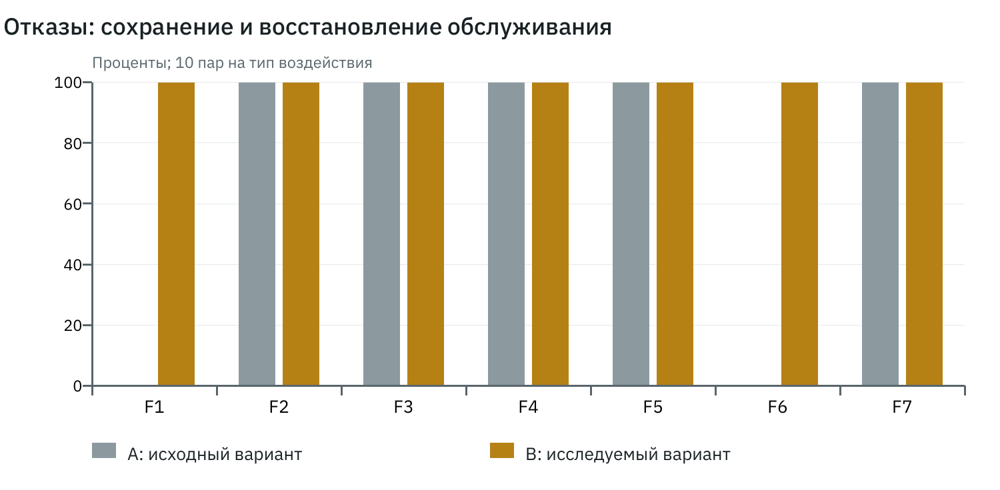
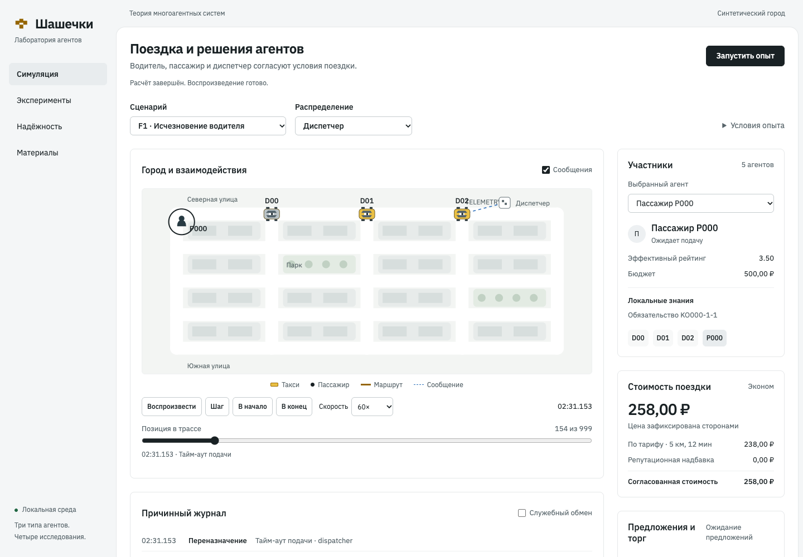

# Лабораторная работа №4

# Устойчивость системы к неблагоприятным воздействиям

Дисциплина: теория многоагентных систем. Дата: 31 октября 2026 года.

## Цель и условия

Внести управляемые воздействия F1–F7, выявить отказ по причинной трассе, включить ограничения и повторно оценить устойчивость. На каждый тип выполняется 10 пар baseline/protected, всего 140 прогонов и 70 полных пар. В каждой паре одинаковы участники, бюджеты, сообщения и воздействие. Цель и момент активации сохраняются явно; неактивированное воздействие не засчитывается успешным испытанием.

## Воздействия и защитные меры

| Тип | Воздействие | Защита |
| --- | --- | --- |
| F1 | Исчезновение водителя после подтверждения | Срок подачи, отзыв, версия +1, не более двух переназначений |
| F2 | Ложная цена 99 руб. ниже минимума | Проверка структуры и тарифного минимума; проверка наблюдаемой правдоподобности ETA/позиции |
| F3 | Повтор доставки CONFIRM | ID сообщения, версия и допустимый переход |
| F4 | Неисправный диспетчер создаёт второе назначение | Атомарная проверка согласий, занятости и существующего обязательства |
| F5 | Подменённая цель: цикл REDELEGATE | Ограничение числа действий и состояния переговоров |
| F6 | Диспетчер недоступен до 20 с | Запрет новых обязательств, сохранение очереди, повтор после восстановления |
| F7 | Поддельное репутационное событие | Авторизация по факту среды, однократный проверенный реестр |

В обоих профилях сохраняются физическая проверка посадки/завершения и целостность реестра рейтинга. baseline не обязан нарушать эти неизменяемые ограничения. Уменьшение защиты не означает разрешение телепортации или поддельных денег.

## Методика и показатели

На каждый вариант заранее сохраняется один и тот же InputBundle; внутри пары совпадает input_hash. Псевдослучайные потоки orders, characteristics и communication инициализируются независимыми SHA-256-метками seed. Основные seeds: 0–9. Средние вычисляются по 10 прогонам; Δ = B − A; SD — выборочное стандартное отклонение десяти парных разностей. Для пропусков показываются отдельные числа доступных наблюдений; отсутствие поездки не подменяется нулевой ценой или ожиданием.

Доля обслуживания = completed / все заказы; cancelled, expired, failed и censored учитываются отдельно. Ожидание измеряется от заявки до посадки, выполнение — до завершения. Конверты и их UTF-8-байты считаются при отправке. Условные затраты координации: 1 копейка на отправку + 1 копейка на 1000 байт + 1 копейка на решение; итог округляется до копейки. Это исследовательская шкала, не реальная стоимость связи.

Прибыль = выручка завершённых поездок − затраты фактического движения, включая предварительную подачу обоих кандидатов. Отрицательная прибыль допустима. Jain = (Σx)² / (n Σx²) по выручке всех водителей, включая нулевые доходы; при всех нулях показатель не определён. Вычислительное время perf_counter хранится отдельно и не входит в каноническое сравнение.

## Парные результаты

| Тип | Обсл. A | Обсл. B | Наруш. A | Наруш. B | Диагн. B, с | Восст. B, с |
| --- | --- | --- | --- | --- | --- | --- |
| F1 | 0.00 | 1.00 | 0.00 | 0.00 | 148.90 | 151.08 |
| F2 | 1.00 | 1.00 | 1.00 | 0.00 | 2.09 | не применимо |
| F3 | 1.00 | 1.00 | 0.00 | 0.00 | 0.19 | не применимо |
| F4 | 1.00 | 1.00 | 1.00 | 0.00 | 0.00 | не применимо |
| F5 | 1.00 | 1.00 | 0.00 | 0.00 | 2.00 | не применимо |
| F6 | 0.00 | 1.00 | 0.00 | 0.00 | 0.09 | 22.18 |
| F7 | 1.00 | 1.00 | 0.00 | 0.00 | 0.00 | не применимо |

A — baseline, B — protected. Обслуживание и нарушения показаны как средние по 10 малым прогонам; диагностика/восстановление — средние доступных измерений. Для F1 и F6 восстановление означает новое подтверждённое обслуживание после прерывания доступности. Для F2–F5 и F7 обслуживание сохраняется, поэтому «восстановление» неприменимо. Все воздействия активированы в 140 из 140 прогонов. Полная матрица с моментами, целями, причинами null и исходами: `evidence/faults/matrix.csv`; все парные Δ и SD: observations.csv и summary.json.

## Разбор результатов

F1: baseline завершает ожидание истечением; защищённый профиль отзывает недействующее обязательство и назначает другого водителя. F2: baseline принимает цену ниже минимума, защищённый отклоняет её и выбирает другого кандидата. Правдоподобная ложь, не противоречащая доступным наблюдениям, остаётся ограничением проверки.

F3: оба профиля завершают поездку один раз; protected явно отбрасывает повторы. F4: baseline создаёт противоречивое логическое назначение, но физическая проверка не допускает двух посадок; protected блокирует второе обязательство. F5: поездка в обоих вариантах обслужена, однако baseline продолжает патологический обмен до горизонта 600 с. Только protected завершает протокол естественно. Достижение горизонта не считается успешным срабатыванием защиты.

F6: оба профиля безопасно не подтверждают новые обязательства во время недоступности. После восстановления protected возобновляет обработку очереди и обслуживает пассажира; baseline теряет обслуживание. Безопасная остановка и доступность — разные свойства. F7: неподтверждённая история отклонена в обоих профилях; успешная защита реестра не является доказательством различия вариантов.

## Контрольные причинные фрагменты

### F1: контрольная защищённая трасса, seed 0

| seq | Время, мс | Событие / причина |
| --- | --- | --- |
| 24 | 2429 | confirmed: Цена, тариф, версия и исполнитель зафиксированы |
| 28 | 2529 | fault_activated: F1 |
| 153 | 151429 | reassigned: Тайм-аут подачи |
| 170 | 153715 | confirmed: Цена, тариф, версия и исполнитель зафиксированы |

### F2: контрольная защищённая трасса, seed 0

| seq | Время, мс | Событие / причина |
| --- | --- | --- |
| 1 | 0 | fault_activated: F2 |
| 12 | 2143 | protection: Цена ниже минимума тарифа |
| 26 | 2429 | confirmed: Цена, тариф, версия и исполнитель зафиксированы |

### F3: контрольная защищённая трасса, seed 0

| seq | Время, мс | Событие / причина |
| --- | --- | --- |
| 24 | 2429 | confirmed: Цена, тариф, версия и исполнитель зафиксированы |
| 25 | 2429 | fault_activated: F3 |

### F4: контрольная защищённая трасса, seed 0

| seq | Время, мс | Событие / причина |
| --- | --- | --- |
| 24 | 2429 | confirmed: Цена, тариф, версия и исполнитель зафиксированы |
| 28 | 2529 | fault_activated: F4 |
| 31 | 2529 | protection: Атомарная проверка отклонила противоречивое назначение |

### F5: контрольная защищённая трасса, seed 0

| seq | Время, мс | Событие / причина |
| --- | --- | --- |
| 366 | 288429 | fault_activated: F5 |
| 414 | 290430 | protection: Изменённая цель ограничена состоянием и числом действий |
| 427 | 290715 | confirmed: Цена, тариф, версия и исполнитель зафиксированы |

### F6: контрольная защищённая трасса, seed 0

| seq | Время, мс | Событие / причина |
| --- | --- | --- |
| 1 | 0 | fault_activated: F6 |
| 31 | 20000 | tool_restored: Средство восстановлено |
| 58 | 22286 | confirmed: Цена, тариф, версия и исполнитель зафиксированы |

### F7: контрольная защищённая трасса, seed 0

| seq | Время, мс | Событие / причина |
| --- | --- | --- |
| 6 | 100 | fault_activated: F7 |
| 7 | 100 | protection: Поддельное репутационное событие отклонено проверенным реестром |
| 26 | 2429 | confirmed: Цена, тариф, версия и исполнитель зафиксированы |

## Дополнительные граничные проверки

Автотесты проверяют исчезновение после посадки: поездка получает failed, пассажир остаётся в фактической позиции, выручка завершённой поездки не начисляется. Возврат старого обязательства, повторная посадка и повторное COMPLETE не дают второй поездки или выручки. Поддельная строка source=environment без авторизации фактом среды не меняет рейтинг. Пределы движка сохраняют отдельный исход limit_reached.

## Вывод и остаточные ограничения

Защищённый профиль сохраняет единственность обязательств, ограничивает патологический обмен и восстанавливает обслуживание в испытанных F1/F6. Он не решает проблему любой правдоподобной лжи и не устраняет единственную точку отказа. Проверены отдельные воздействия на синтетических входах; сочетания отказов, резервирование диспетчера и непредусмотренные стратегии требуют самостоятельных исследований.

## Источники и отдельные приложения

1. «Лабораторные-МАС.pdf», с. 1–2: содержание четырёх работ и общий комплект сдачи.
2. «МАС. Лекция 1.pdf», с. 6: свойства агента.
3. «МАС. Лекция 2.pdf», с. 6, 17, 19, 22, 24, 27: состояние, знания, граф связи, показатели.
4. «МАС. Лекция 3.pdf», с. 14, 17, 27, 29: решения, роли и полномочия.
5. «МАС. Лекция 4.pdf», с. 18–19, 24, 28: диспетчеризация, аукционы, коммуникационные затраты.
6. «МАС. Лекция 5.pdf», с. 9, 22, 25, 31, 33, 35: конфликт, контрпредложения, арбитраж, обязательства, репутация.

Страницы отсчитываются от первой страницы PDF. Формулы тарифов и параметры опытов являются проектными решениями, а не обязательными положениями лекций.

Исходный код предоставлен отдельно: `evidence/source.zip`. Входы всех пар и полные отобранные прогоны с конфигурациями, трассами, показателями и контрольными суммами: `evidence/demo.zip`. Компактные парные таблицы: `evidence/`; инструкция запуска: `README.md`. Архивы находятся рядом с отчётами в локальном проекте; внешняя публикация не выполнялась.
